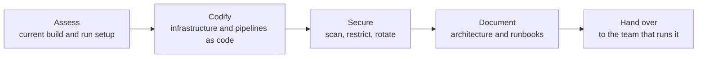

<!-- Header banner -->

  

  
  

I build secure delivery pipelines and container platforms, mostly on Azure and Kubernetes, and I lead a small DevOps team that supports several client platforms.

## What I work with

  

  
  
  
  
  
  

Full stack by area

| Area | Tools |
|---|---|
| Cloud | Azure (AKS, Azure DevOps, ACR, Entra ID), AWS (EC2, SSM, S3, Secrets Manager) |
| CI/CD | Azure DevOps, GitLab CI, GitHub Actions |
| Containers | Docker, Docker Compose, Kubernetes, Helm |
| Infrastructure as code | Terraform |
| Security | Trivy image scanning, least-privilege access, runtime secrets management, hardened container defaults |
| Documentation | High-level and low-level architecture documents, design decision records, runbooks |

## Selected work

Both projects are reference versions of patterns I built for a multi-service SaaS platform. Names, addresses and other specifics are placeholders.

<table>
<tr>
<td width="50%" valign="top">

### [GitLab CI/CD secure container pipeline](https://github.com/<your-username>/Gitlab-CI-CD-secure-container-pipeline)

Builds 11 images in parallel, scans each with Trivy, blocks the release on fixable HIGH or CRITICAL findings, and deploys to AWS through SSM with no SSH keys.

</td>
<td width="50%" valign="top">

### [Hardened Docker and Compose stack](https://github.com/<your-username>/<docker-stack-repo>)

Distroless non-root images, a read-only runtime with all capabilities dropped, and per-service NATS and Postgres credentials.

</td>
</tr>
</table>

## How I work

## Leadership

I lead a DevOps team of two engineers across several client platforms. Client details stay private, so what you see here is rebuilt from scratch.

## Work with me

I'm open to consulting engagements and full-time roles.

  
  

  

